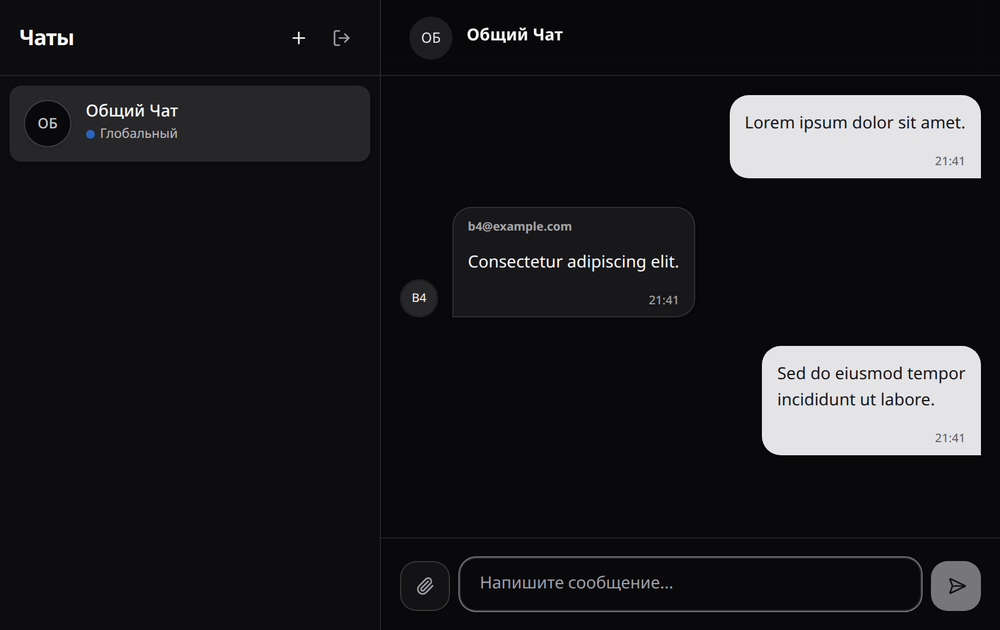

# ThatChat

ThatChat позволяет общаться в общем чате и личных переписках через браузер, отправлять текст и файлы, читать сохранённые сообщения. В репозитории собраны сервер, браузерный клиент и документация программы.

## Документация

| Документ | Содержание | Файлы |
| --- | --- | --- |
| Руководство пользователя | Регистрация, чаты, сообщения, вложения и действия при ошибках | [Открыть руководство](docs/kt3-user-guide.md), [PDF](docs/kt3-user-guide.pdf) |
| Техническое задание | Назначение программы и требования к её работе | [PDF](docs/kt1-specification.pdf) |
| Архитектура | Диаграммы серверной части с пояснениями | [PDF](docs/kt2-architecture.pdf) |
| Диаграмма классов | Структура серверной части | [PNG](docs/diagrams/class-diagram.png), [Draw.io](docs/diagrams/class-diagram.drawio) |
| Диаграмма последовательности | Сохранение и доставка сообщения | [PNG](docs/diagrams/sequence-diagram.png), [Draw.io](docs/diagrams/sequence-diagram.drawio) |

## Возможности

- Регистрация по адресу электронной почты и вход по паролю.
- Общий чат для зарегистрированных пользователей.
- Создание личной переписки по адресу собеседника.
- Отправка текста с доставкой в открытый чат.
- Отправка одного файла с текстом или без него, просмотр изображений и открытие вложений.
- Чтение сохранённой истории при выборе чата.

## Системные требования

| Для чего | Что требуется |
| --- | --- |
| Сервер | .NET SDK 10 |
| Браузерный клиент | Node.js 24; npm |
| Работа в приложении | Браузер с поддержкой JavaScript и локального хранилища |
| Первый запуск | Доступ к NuGet и реестру npm для загрузки зависимостей |

Сервер использует SQLite. Отдельная установка сервера базы данных не требуется.

## Установка и запуск

Откройте два терминала в корне скачанного репозитория `ThatChat`.

В первом терминале запустите сервер:

```bash
cd backend/ThatChat.Backend
dotnet run --launch-profile http
```

Сервер начнёт принимать запросы по адресу `http://localhost:5042`. Профиль `http` включает среду Development, в которой программа применяет миграции и создаёт базу данных при первом запуске. Запускайте сервер из указанного каталога, чтобы загруженные файлы сохранялись в его `wwwroot/uploads`.

Во втором терминале установите зависимости, скопируйте настройки и запустите клиент:

```bash
cd frontend
npm ci
cp .env.example .env
npm run dev -- --host localhost --port 5173 --strictPort
```

Файл `.env.example` задаёт адрес сервера:

```dotenv
VITE_API_URL=http://localhost:5042
```

Откройте [http://localhost:5173](http://localhost:5173). Оставьте оба терминала открытыми во время работы. Для остановки нажмите Ctrl+C в каждом терминале.

Для повторного запуска клиента достаточно последней команды. Установку зависимостей и копирование настроек выполняйте при первоначальной подготовке.

## Пример использования

1. Откройте "Регистрация", укажите адрес `a7@example.com` и пароль длиной не менее четырёх символов, нажмите "Зарегистрироваться".
2. Выберите "Общий Чат" в списке слева.
3. Введите "Lorem ipsum dolor sit amet." и нажмите Enter. Сообщение появится в переписке.
4. Нажмите кнопку со скрепкой, выберите файл `sample.txt` размером меньше 20 МиБ и нажмите кнопку отправки.
5. Чтобы начать личную переписку, нажмите кнопку с плюсом и укажите адрес другого зарегистрированного пользователя, например `b4@example.com`.

Shift+Enter добавляет перенос строки. Допустимая длина текста составляет до 10 000 символов. Перед повторной отправкой после сбоя проверьте историю чата.



## Структура проекта

```text
ThatChat/
├── README.md
├── backend/
│   ├── ThatChat.Backend.sln
│   ├── ThatChat.Backend/          сервер и миграции базы данных
│   └── ThatChat.Backend.Tests/    тесты серверной части
├── frontend/                     клиент Vue и его тесты
└── docs/
    ├── kt1-specification.pdf     техническое задание
    ├── kt2-architecture.pdf      пояснения к диаграммам
    ├── kt3-user-guide.pdf        руководство пользователя
    ├── kt3-user-guide.md         руководство для чтения в браузере
    ├── diagrams/                 диаграммы Draw.io и PNG
    └── screenshots/              снимки интерфейса
```
