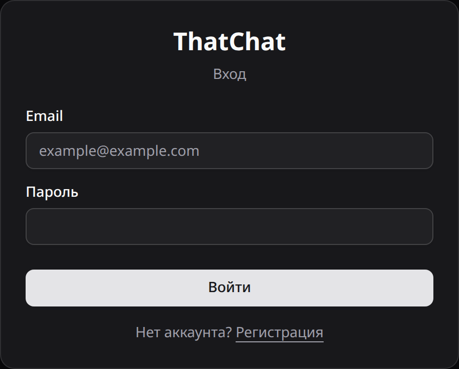
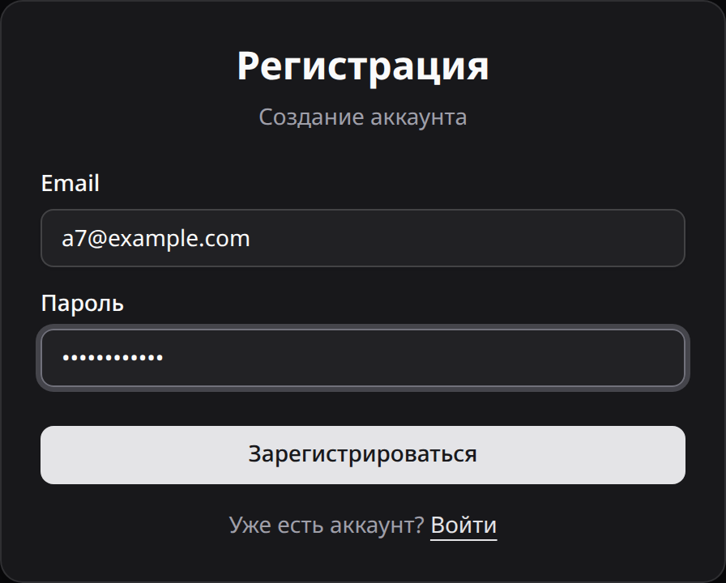
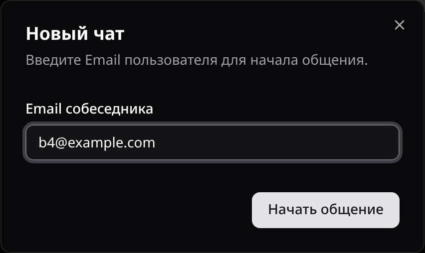
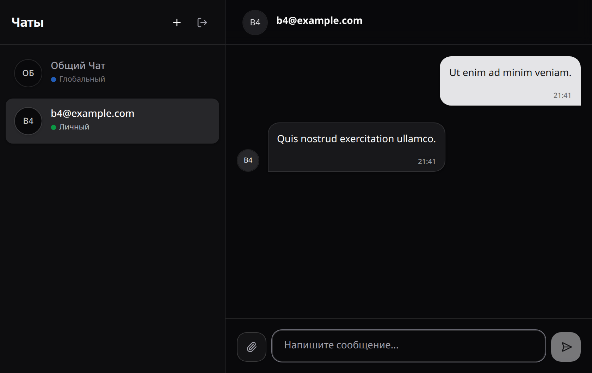
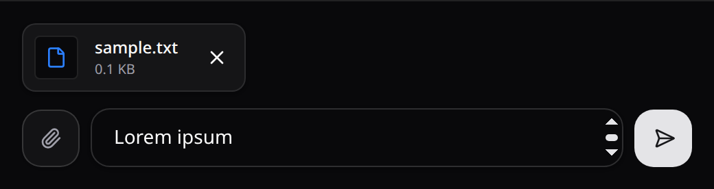
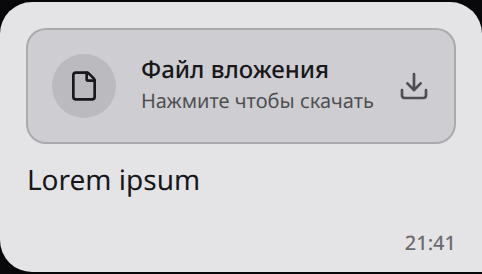
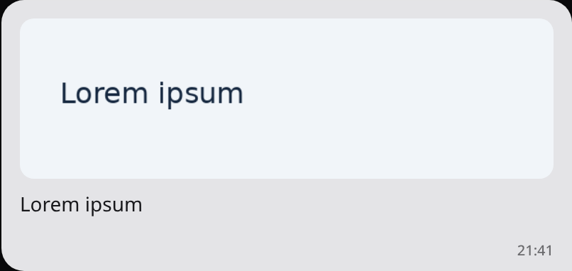
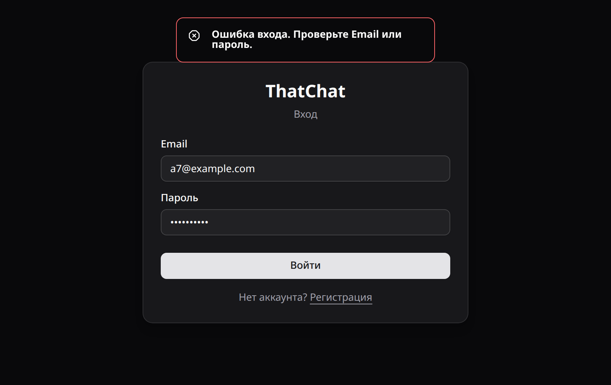

# ThatChat

Руководство пользователя

## 1. Назначение программы

ThatChat предназначен для обмена сообщениями и файлами через браузер. Пользователь может общаться в общем чате или создать личную переписку с другим зарегистрированным пользователем.

В общем чате сообщения доступны всем зарегистрированным пользователям. Личные чаты отображаются в списке их участников. При выборе чата программа загружает сохранённую историю переписки.

Для работы достаточно уметь пользоваться браузером, вводить текст и выбирать файлы на компьютере. В примерах используются адреса a7@example.com и b4@example.com.

## 2. Условия выполнения программы

Для общения откройте приложение в браузере. Сервер и браузерный клиент должны работать на протяжении сеанса. Для личной переписки собеседник должен заранее зарегистрироваться.

При самостоятельном запуске на своём компьютере установите программы, перечисленные в таблице 1. При первой установке понадобится доступ к интернету для загрузки зависимостей.

Таблица 1. Средства для запуска и работы

| Назначение | Условие |
| --- | --- |
| Запуск сервера | .NET SDK 10 |
| Запуск браузерного клиента | Node.js 24 и npm |
| Работа в приложении | Браузер с включённым JavaScript и доступным локальным хранилищем |
| Текст сообщения | Не более 10 000 символов |
| Вложение | Один непустой файл размером меньше 20 МиБ, то есть меньше 20 971 520 байт |
| Учётная запись | Адрес электронной почты и пароль длиной не менее четырёх символов |

## 3. Выполнение программы

### 3.1. Запуск на своём компьютере

Программа поставляется в виде исходного кода. Если приложение уже запущено, перейдите к входу в учётную запись.

1. Скачайте репозиторий ThatChat и откройте его корневую папку.
2. Откройте терминал в этой папке. Выполните команды запуска сервера, приведённые ниже.
3. Откройте второй терминал в корневой папке ThatChat. Выполните команды установки и запуска клиента, приведённые ниже.
4. Откройте в браузере адрес http://localhost:5173. Появится страница входа.
5. Оставьте оба терминала открытыми до завершения работы.

Первый терминал. Запуск сервера

```bash
cd backend/ThatChat.Backend
dotnet run --launch-profile http
```

Второй терминал. Установка и запуск клиента

```bash
cd frontend
npm ci
cp .env.example .env
npm run dev -- --host localhost --port 5173 --strictPort
```



Рисунок 1. Страница входа в ThatChat

### 3.2. Регистрация и вход

1. На странице входа нажмите ссылку "Регистрация".
2. Введите свой адрес в поле "Email".
3. Введите пароль длиной не менее четырёх символов в поле "Пароль".
4. Нажмите "Зарегистрироваться". После создания учётной записи программа выполнит вход и откроет список чатов.
5. При следующем входе заполните поля "Email" и "Пароль" на странице входа.
6. Нажмите "Войти". Откроется окно чатов.



Рисунок 2. Форма регистрации учётной записи

### 3.3. Выбор чата и чтение истории

Список чатов находится слева. Общая переписка имеет название "Общий Чат" и отметку "Глобальный". Личная переписка имеет отметку "Личный".

1. Нажмите на нужный чат в списке слева. Название выбранного чата появится над перепиской.
2. Прочитайте сообщения в центральной части окна. Ваши сообщения располагаются справа, сообщения других участников слева.
3. Прокрутите переписку вверх, чтобы прочитать более ранние сообщения.
4. Чтобы перейти в другую переписку, нажмите на её название в списке слева.

В общем чате над сообщениями других участников указан адрес автора. Время отправки находится внизу сообщения.


Рисунок 3. Общий чат, список переписок и история сообщений

### 3.4. Создание личной переписки

1. Нажмите кнопку с плюсом рядом с заголовком "Чаты". Откроется окно "Новый чат".
2. Введите адрес зарегистрированного собеседника в поле "Email собеседника", например b4@example.com. Используйте адрес, который он указал при регистрации.
3. Нажмите "Начать общение". Программа откроет личную переписку и покажет сообщение "Чат создан".
4. Введите и отправьте сообщение. Если переписка с этим собеседником уже существует, программа откроет её.



Рисунок 4. Создание личного чата по адресу собеседника

### 3.5. Отправка текста

1. Выберите чат, в который хотите отправить сообщение.
2. Введите текст в поле "Напишите сообщение..." внизу окна, например "Lorem ipsum dolor sit amet.".
3. Чтобы добавить перенос строки, нажмите Shift+Enter.
4. Для отправки нажмите Enter или кнопку со стрелкой справа от поля ввода.
5. Убедитесь, что сообщение появилось в переписке.

Пустое сообщение без вложения не отправляется. Если поле ввода недоступно, дождитесь подключения к серверу. Действия при сбоях описаны в разделе 4.



Рисунок 5. Открытая личная переписка

### 3.6. Отправка и открытие файлов

1. Выберите нужный чат.
2. Нажмите кнопку со скрепкой слева от поля ввода. Откроется окно выбора файла.
3. Выберите один непустой файл размером меньше 20 МиБ. Над полем ввода появятся его имя и размер.
4. Чтобы убрать выбранное вложение до отправки, нажмите крестик рядом с именем файла.
5. При необходимости введите пояснение к файлу. Можно отправить файл без текста.
6. Нажмите кнопку отправки или Enter. Убедитесь, что вложение появилось в переписке.
7. Нажмите на изображение в сообщении, чтобы открыть его в новой вкладке.
8. Для другого типа файла нажмите карточку "Файл вложения". Браузер откроет файл в новой вкладке или предложит его сохранить.

После отправки программа показывает изображения в переписке, а другие файлы обозначает карточкой "Файл вложения". Исходное имя в этой карточке не отображается.



Рисунок 6. Выбранное вложение и кнопка удаления до отправки



Рисунок 7. Файл в отправленном сообщении



Рисунок 8. Изображение в отправленном сообщении

### 3.7. Завершение работы

1. Нажмите кнопку "Выйти" со значком выхода рядом с заголовком "Чаты". Откроется страница входа.
2. Если вы запускали программу самостоятельно, нажмите Ctrl+C в каждом из двух терминалов.

## 4. Сообщения программы

Программа показывает уведомления о результате действий и ошибках. В таблицах приведён текст уведомлений и действия пользователя.

Таблица 2. Уведомления об успешных действиях

| Сообщение | Что означает |
| --- | --- |
| Аккаунт создан! Входим... | Регистрация завершена. Программа начинает вход в новую учётную запись. |
| Добро пожаловать! | Вход выполнен. Открывается окно чатов. |
| Чат создан | Личная переписка создана или найдена среди существующих чатов. |



Рисунок 9. Уведомление об ошибке входа

Таблица 3. Предупреждения и ошибки

| Сообщение | Что означает | Что делать |
| --- | --- | --- |
| Заполните все поля | Не заполнен адрес или пароль при регистрации. | Заполните поля "Email" и "Пароль". |
| Пожалуйста, заполните все поля | Не заполнен адрес или пароль при входе. | Заполните поля "Email" и "Пароль". |
| Пароль слишком короткий (минимум 4 символа) | Введено меньше четырёх символов. | Введите пароль длиной не менее четырёх символов. |
| Ошибка регистрации. Возможно, email уже занят. | Программа не завершила регистрацию. Адрес может быть занят, но сообщение не уточняет причину. | Если у вас уже есть учётная запись, откройте страницу входа. Иначе проверьте адрес и доступность сервера. |
| Ошибка входа. Проверьте Email или пароль. | Вход не выполнен. Возможны неверные данные или недоступность сервера. | Проверьте адрес, пароль и раскладку клавиатуры. Убедитесь, что сервер работает. |
| Ошибка. Пользователь не найден? | Личная переписка не открыта. Возможны неверный адрес, попытка создать чат с собой или ошибка сервера. | Уточните у собеседника адрес регистрации. Укажите адрес другого пользователя и повторите действие. |
| Файл слишком большой (максимум 20 МБ) | Выбранный файл превышает ограничение размера. | Выберите непустой файл размером меньше 20 МиБ. |
| Не удалось отправить сообщение | При отправке текста или вложения произошла ошибка. | Проверьте доступность сервера, длину текста и размер файла. Обновите страницу и проверьте историю чата перед повторной отправкой. |
| Ошибка при отправке запроса на сервер | Браузер не получил ответ на запрос к серверу. Уведомление содержит пояснение: "Проверьте подключение к интернету. Или возможно сервер недоступен." | Проверьте подключение к сети и работу сервера. После восстановления связи обновите страницу. |

Если сообщения не появляются или история остаётся пустой, обновите страницу и выберите чат заново. При необходимости войдите повторно. Перед повторной отправкой проверьте историю, чтобы не отправить сообщение дважды.

После неудачной отправки поле ввода и выбранное вложение очищаются. Если сообщения нет в истории, введите текст и выберите файл повторно. При повторении ошибки запишите её текст и время появления. Передайте эти сведения человеку, который запустил сервер.
